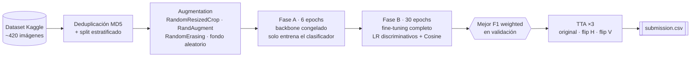

# Clasificador de frutas — Transfer Learning con EfficientNet-B0


Clasificador de imágenes de frutas y verduras (manzana, banana, uva, papa y tomate) para la competencia de Kaggle **UTN-IA 2026: Fruit & Vegetable Classifier**. Parte de una CNN entrenada desde cero que llega al 76 % de accuracy en validación y la reemplaza por **EfficientNet-B0 preentrenado en ImageNet**, con fine-tuning en dos fases y data augmentation pensado contra el cambio de fondo entre train y test. El resultado es un **F1 weighted perfecto (1,0) en el leaderboard de Kaggle**: las 89 imágenes del test bien clasificadas.

Trabajo práctico de **Inteligencia Artificial** (UTN Facultad Regional Rosario, 2026): *Redes Neuronales Convolucionales*.

> 📌 **Autoría.** Las **Etapas 1 y 2** (preparación de datos, CNN desde cero y baseline para la competencia) son el notebook de clase provisto por la cátedra ([gforconi/UTNIA2025](https://github.com/gforconi/UTNIA2025)) y se incluyen como punto de partida. **La Etapa 3 es mi trabajo**: diagnóstico del baseline, transfer learning, entrenamiento, evaluación, submission y bitácora de experimentos.

---

## El problema

| | Train | Test de Kaggle |
|---|---|---|
| Imágenes | ~420 (325 train / 46 val / 46 test en la Etapa 2) | 89 |
| Fondo | Blanco de estudio | Real y variado |
| Métrica | — | **F1 Score Weighted** |

Con tan pocas imágenes y un fondo que cambia entre train y test, el modelo tiende a aprender un atajo como *"fondo blanco + mancha roja = tomate"*, que en el test no existe.

## Estructura del trabajo

| Etapa | Autoría | Qué hace | Resultado |
|---|---|---|---|
| **1. Dataset controlado** | Cátedra | CNN de 3 bloques Conv-BN-ReLU-MaxPool entrenada desde cero a 64×64 sobre un dataset de estudio (1.600 imágenes de train) | 100 % de accuracy en validación |
| **2. Dataset realista** | Cátedra | La misma CNN sobre el dataset oficial de la competencia, con augmentation más agresivo, y primer `submission.csv` | 76,1 % de accuracy en validación; F1 en Kaggle de 0,634 como máximo |
| **3. Transfer Learning** | **Propia** | EfficientNet-B0 preentrenado, fine-tuning en dos fases, augmentation contra el domain gap y TTA | **F1 weighted 1,0 en Kaggle** |

---

## Etapa 3: qué hice

### Diagnóstico del baseline

| # | Problema en la Etapa 2 | Contramedida en la Etapa 3 |
|---|---|---|
| 1 | **Muy pocos datos.** Una CNN de 2,2 M de parámetros sobre 325 imágenes no puede aprender features desde cero. | **Transfer learning** con EfficientNet-B0, preentrenado con 1,28 M de imágenes de ImageNet. |
| 2 | **Resolución de 64×64.** Se pierde la textura (la piel de una papa frente a la de un tomate). | **224×224**, la resolución nativa del preentrenamiento. |
| 3 | **Domain gap.** Train con fondo blanco y test con fondos reales. El baseline además pegaba las imágenes con transparencia siempre sobre blanco. | **Augmentation orientado al fondo** y recomposición sobre fondos aleatorios. |
| 4 | **Checkpoint elegido por `val_loss`**, pero la competencia mide F1 weighted. | Checkpoint elegido por **mejor F1 weighted** en validación. |
| 5 | **Posible data leakage.** El split copiaba imágenes desde dos rutas, y la misma imagen podía quedar en train y en val. | **Dataset reconstruido** con deduplicación por hash MD5 y split estratificado. |

### Pipeline



### Configuración del Experimento #1

| Ítem | Valor |
|---|---|
| Arquitectura | EfficientNet-B0 (`IMAGENET1K_V1`), clasificador reemplazado por `Dropout(0.4) + Linear(1280 → 5)` |
| Resolución | 224×224 |
| Entrenamiento | Fase A: 6 epochs con el backbone congelado. Fase B: 30 epochs con todo descongelado. |
| Optimizador | AdamW con LR discriminativos (backbone `3e-5`, clasificador `3e-4`) + `CosineAnnealingLR` |
| Loss | CrossEntropy con label smoothing 0,1 |
| Augmentation | `RandomResizedCrop(0.4–1.0)`, flips, `RandAugment(2, 9)`, `RandomErasing(0.25)` y fondo aleatorio para imágenes con transparencia |
| Selección del checkpoint | Mejor F1 weighted en validación |
| Eficiencia | AMP (mixed precision) en una Tesla T4: unos 13 s por epoch |
| Inferencia | TTA ×3 (promedio de softmax) |

---

## Resultados

| Modelo | Resolución | Parámetros entrenables | Val Accuracy | Val F1 weighted | **F1 weighted en Kaggle** |
|---|---|---|---|---|---|
| CNN desde cero (Etapa 2) | 64×64 | 2.192.389 | 76,1 % | no se medía | ≤ 0,634 |
| **EfficientNet-B0 (Etapa 3)** | 224×224 | 4.013.953 | **97,9 %** | **0,979** | **1,000** |

El baseline predijo `grapes` en 38 de las 89 imágenes de test, cuando hay 22. Como el F1 de 1,0 implica que las predicciones de EfficientNet-B0 coinciden con las etiquetas reales, se puede calcular que el F1 del baseline no supera 0,634 aunque haya acertado todo lo posible dentro de cada clase.

**Detalle por clase (mejor checkpoint, epoch 17 de la Fase B):**

| Clase | Precision | Recall | F1 |
|---|---|---|---|
| apple | 1,000 | 1,000 | 1,000 |
| banana | 1,000 | 1,000 | 1,000 |
| grapes | 1,000 | 1,000 | 1,000 |
| potato | 1,000 | 0,889 | 0,941 |
| tomato | 0,909 | 1,000 | 0,952 |

La única confusión es una papa clasificada como tomate.

**Termómetro del domain gap**

La validación local sale del mismo dominio de fondo blanco que el train, así que es optimista. Por eso agregué una **validación "HARD"**, con recortes y variaciones de color fuertes, como estimación más honesta del test de Kaggle:

| Validación | F1 weighted |
|---|---|
| Normal (fondo blanco) | 0,979 |
| HARD (proxy del test) | 0,929 |
| **Brecha estimada** | **+0,049** |

Una brecha menor a 0,10 indica que el modelo ya no depende tanto del fondo. El resultado en Kaggle (1,0) quedó incluso por encima de la validación normal.

---

## Decisiones de diseño destacadas

- **¿Por qué EfficientNet-B0 y no ResNet18?** Tiene menos de la mitad de parámetros (5,3 M frente a 11,7 M) y mejor top-1 en ImageNet (77,7 % frente a 69,8 %). Con 420 imágenes, menos parámetros significa menos riesgo de sobreajuste.
- **Entrenamiento en dos fases.** Si se descongela el backbone desde el primer epoch, los gradientes del clasificador nuevo, inicializado al azar, destruyen los pesos de ImageNet. Primero se calibra el clasificador y recién después se ajusta todo.
- **LR discriminativos.** Las capas tempranas detectan bordes y colores, algo universal que ya viene resuelto de ImageNet. El clasificador es nuevo y necesita aprender rápido, así que lleva un LR 10 veces mayor.
- **Optimizar lo que se evalúa.** El checkpoint se elige por F1 weighted y no por loss, porque un modelo puede bajar la loss volviéndose más confiado en las clases que ya acierta, sin mejorar en las que falla.
- **Formato de submission a prueba de errores.** El `image_id` se toma del `sample_submission.csv` de la competencia, respetando su formato y su orden. Un formato distinto da score 0 aunque el modelo sea perfecto.
- **Auditoría de las predicciones menos confiables.** Se grafican las 12 imágenes de test con menor confianza (la confianza media es 79,6 %) para orientar el próximo experimento.

---

## Cómo ejecutarlo

1. Abrí el notebook en **Google Colab** y elegí **Entorno de ejecución → Cambiar tipo de entorno → GPU T4**.
2. Creá un token de API en [kaggle.com](https://www.kaggle.com) → *Settings* → *API* → *Create New Token*, y pegalo en la celda `os.environ["KAGGLE_API_TOKEN"] = ""`. **No subas el notebook con el token puesto.**
3. Uníte a la [competencia](https://www.kaggle.com/competitions/utn-ia-2026-fruit-vegetable-classifier) para poder descargar el test.
4. **Entorno de ejecución → Ejecutar todo.** La Etapa 3 genera `submission_efficientnet.csv` para subir al leaderboard.

**Datasets** (licencia Apache 2.0):
- Etapa 1: [UTN-IA 2026 · Estudio Visual - Etapa 1](https://www.kaggle.com/datasets/geronimoforconi/utn-ia-2026-estudio-visual-etapa-1)
- Etapas 2 y 3: [UTN-IA 2026 · Food Classification - Training Set](https://www.kaggle.com/datasets/geronimoforconi/utn-ia-2026-food-classification-training-set)

## Estructura del repositorio

```text
├── Clasificador_Frutas_UTN_EfficientNet.ipynb   # notebook completo: Etapas 1 y 2 (cátedra) + Etapa 3 (propia)
└── README.md
```

## Stack

Python · PyTorch 2.x · torchvision (EfficientNet-B0) · scikit-learn · pandas · NumPy · Matplotlib · Seaborn · Pillow · Kaggle API · Google Colab (GPU T4)

## Trabajo futuro

Con el leaderboard en 1,0, los próximos pasos apuntan a la robustez más que al puntaje: el test tiene solo 89 imágenes, así que un resultado perfecto no garantiza el mismo desempeño sobre un conjunto más grande.

- Evaluar el modelo sobre fotos propias o un dataset externo, con fondos y luz más variados.
- Validación cruzada estratificada, para tener una estimación más estable con tan pocas imágenes.
- Augmentation de mezcla (MixUp y CutMix) y ensemble de varios backbones, para reducir la varianza.
- Sumar más clases de frutas y verduras.

---

## Créditos

- **Etapas 1 y 2, datasets y competencia:** cátedra de Inteligencia Artificial, UTN FRRo ([gforconi/UTNIA2025](https://github.com/gforconi/UTNIA2025)).
- **Etapa 3:** Lucas San Pedro

Universidad Tecnológica Nacional, Facultad Regional Rosario · Ingeniería en Sistemas de Información · Inteligencia Artificial · 2026
